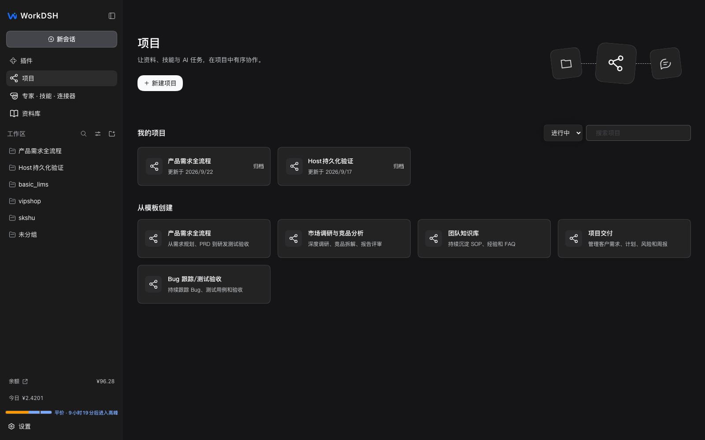
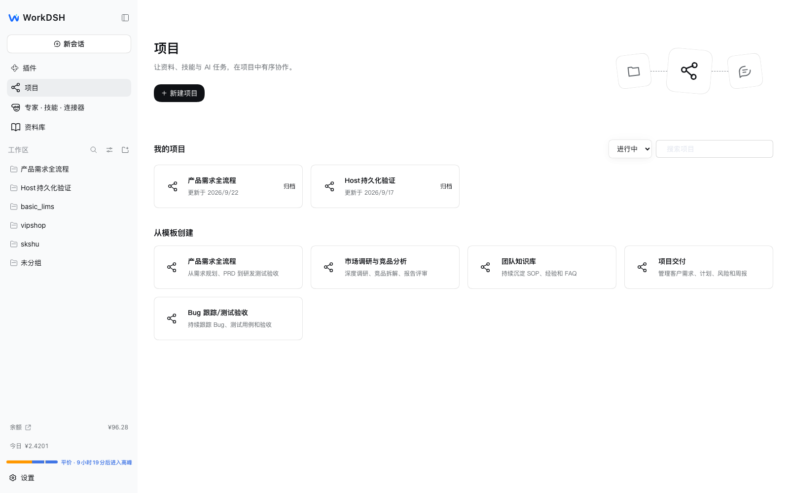
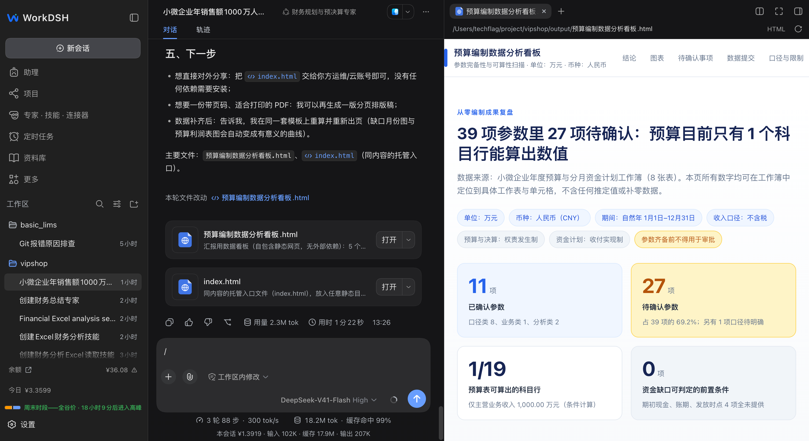

<p align="center"></p>
<h1 align="center">WorkDSH</h1>
<p align="center"><strong>把工作交给 AI，看清过程，拿到成果。</strong></p>
<p align="center"><a href="README.md">English</a> · 简体中文</p>

WorkDSH 是基于官方 DeepSeek Harness 的开源 AI 工作台。把对话、资料与能力组织到项目里，复用本地资料库，在任务旁查看和编辑交付成果。

**桌面版 v2.0.6-alpha.1 · Web/插件 v0.1.0-alpha.14 · Alpha 预览版**

[桌面版下载](https://github.com/techflag/workdsh/releases/tag/desktop-v2.0.6-alpha.1) · [Web/插件下载](https://github.com/techflag/workdsh/releases/tag/v0.1.0-alpha.14) · [更新说明](https://github.com/techflag/workdsh/releases/tag/v0.1.0-alpha.14) · [快速开始](#快速开始) · [官网](https://techflag.github.io/workdsh/) · [Gitee 镜像](https://gitee.com/techflag/workdsh)

## 下载 WorkDSH 桌面版

| 系统 | 安装包 |
| --- | --- |
| Windows x64 | [下载 Setup.exe](https://github.com/techflag/workdsh/releases/download/desktop-v2.0.6-alpha.1/dsh-plugin-desktop-windows-x64--WorkDSH-2.0.6-alpha.1-x64-Setup.exe) |
| macOS Apple 芯片 | [下载 arm64 DMG](https://github.com/techflag/workdsh/releases/download/desktop-v2.0.6-alpha.1/dsh-plugin-desktop-macos-arm64--WorkDSH-2.0.6-alpha.1-arm64.dmg) |
| macOS Intel | [下载 x64 DMG](https://github.com/techflag/workdsh/releases/download/desktop-v2.0.6-alpha.1/dsh-plugin-desktop-macos-x64--WorkDSH-2.0.6-alpha.1-x64.dmg) |

这批 Alpha 安装包内置 WorkDSH v0.1.0-alpha.14 和官方 Harness 0.1.7-rc.2 Profile，包含 Node 与 Python。任务浏览器复用 Electron，不额外打包浏览器。macOS DMG 是未签名预览包；校验文件见[桌面版 Release](https://github.com/techflag/workdsh/releases/tag/desktop-v2.0.6-alpha.1)。



## 可以做什么

| 功能 | 能力 |
| --- | --- |
| 项目 | 集中管理任务、计划、资产和活动记录，在对话中选择项目能力。 |
| 本地资料库 | 导入资料、浏览目录、搜索和预览文件，把选定修订引用到任务中。 |
| 技能与专家 | 安装可复用技能，发布固定能力修订的专家配置。 |
| 连接器 | 配置 MCP 服务，明确选择任务使用的能力。 |
| Office 成果 | 预览和编辑支持范围内的文档、演示文稿、表格、HTML 与 PDF 工作副本；不同格式的保真范围有差异。 |
| 活动记录 | 查看原生任务与子代理活动；显示专家团名称不代表多个成员已经执行。 |

alpha.14 整包包含 **12 个可安装模块**，包括项目、资料库和受管浏览器会话，并适配 Harness 0.1.7-rc.2 的公开接口。Desktop 中 Agent 操作的网页显示在右侧任务浏览器，与工具操作同一 Electron 页面。附件、输入和发送继续使用 Harness 原生能力。

## 页面截图

以下为本地工作区的完整应用截图。项目、已安装技能和账户数值是使用示例，不是安装包自带的数据。

<details>
<summary>浅色主题：项目主页</summary>



</details>

<details>
<summary>Office 示例：对话与 HTML 成果</summary>



此前的本地预览截图，用于展示成果工作流，不代表 alpha.8 所有文档格式均已验收。

</details>

## Star 趋势

<a href="https://www.star-history.com/?repos=techflag%2Fworkdsh&type=date&legend=top-left">
 <picture>
   <source media="(prefers-color-scheme: dark)" srcset="https://api.star-history.com/chart?repos=techflag/workdsh&type=date&theme=dark&legend=top-left&sealed_token=BRTkOyC4czCEkIyFb5-QxrsC-kaDotBJ8tsjxrWs-UGfmBqfRCXSwieZPlVTCYOjJVEZ29uLvmBjAPREB524J5dPN1jk-UA7ajFdLdrbjumJqoOBeGWmig" />
   <source media="(prefers-color-scheme: light)" srcset="https://api.star-history.com/chart?repos=techflag/workdsh&type=date&legend=top-left&sealed_token=BRTkOyC4czCEkIyFb5-QxrsC-kaDotBJ8tsjxrWs-UGfmBqfRCXSwieZPlVTCYOjJVEZ29uLvmBjAPREB524J5dPN1jk-UA7ajFdLdrbjumJqoOBeGWmig" />
   
 </picture>
</a>

## 快速开始

环境要求：Node.js `^22.19.0 || >=24.0.0`、Corepack/pnpm，以及与所下载发行包 `release-manifest.json` 的 `harness` 字段完全一致的官方 `dsh` CLI。不要使用源码目标版本替代已发布包的版本。

1. 从 [alpha.14 Release](https://github.com/techflag/workdsh/releases/tag/v0.1.0-alpha.14) 下载全部 12 个 `.tgz`、`release-manifest.json`、`SHA256SUMS` 和 `install-workdsh.mjs`，放入同一目录。
2. 升级已有 Profile 时，先停止运行，并保留配置和数据的可恢复备份。
3. 在下载目录执行：

```sh
node install-workdsh.mjs --profile workdsh --dry-run
node install-workdsh.mjs --profile workdsh
```

安装器校验包的校验和，锁定已验证的包管理器和 Harness 传递依赖，并在 Profile 内安装匹配的官方 base、Web 应用与 CLI。**启动时使用安装器打印的 Profile 内 CLI 命令**，避免全局 CLI 与 Profile 运行时来自不同安装位置。匹配的 CLI 不在 PATH 中时，可传入 `--dsh /absolute/path/to/dsh`。

各模块仍独立版本化，通过官方 `dsh plugin` 生命周期安装。准确的包名和版本以发行清单为准；GitHub Release 附件不代表已发布到 npm。

### 旧专家升级

旧目录式专家预设需要通过 **编辑制作文件 → 发布** 显式重新发布，再创建新任务。只读内置专家应先复制为“我的专家”。历史任务和项目绑定保留原有固定修订，不会自动切换到新配置；需要使用新修订的项目绑定也应明确审阅并更新。

### 从源码运行

```sh
corepack pnpm install --frozen-lockfile
corepack pnpm build
corepack pnpm preview:install
corepack pnpm preview
```

预览启动将工作区锁定的 pnpm 同时用于原生插件管理和本地安装。PATH 调整仅作用于预览进程；工作区依赖缺失或版本不符时拒绝启动，不修改全局 pnpm 配置，也不迁移 Profile 的依赖存储。

## 架构与开发

WorkDSH 通过插件、服务和 UI 插槽扩展官方已发布的 Harness 包，不维护修改版上游运行时。业务模块各自拥有领域数据，由整合包组合导航和展示。

```sh
corepack pnpm typecheck
corepack pnpm test:integration
corepack pnpm test:projects
corepack pnpm test:library
corepack pnpm check:versions
```

[发行记录](https://github.com/techflag/workdsh/releases) · [项目规划](https://github.com/techflag/workdsh/issues)

当前为 Alpha 预览版。跨平台安装、长时间真实模型专家团、任意 Office 文件保真和多人治理尚未完整验收。Harness 升级后需复验原生 UI 适配。具体测试范围以本次更新说明为准。

## 开源组件与致谢

感谢以下项目及其维护者。下表列出主要直接依赖和使用范围；完整依赖以各包清单、锁文件及构建产物中的许可清单为准。

| 项目 | 在 WorkDSH 中的用途 | 许可 |
| --- | --- | --- |
| [DeepSeek Harness](https://github.com/deepseek-ai/deepseek-harness) / Cordis | 原生任务、模型执行、技能发现、插件加载、Profile、服务与 UI 扩展底座 | MIT |
| [React](https://github.com/facebook/react) | 功能页面和编辑器 UI | MIT |
| [Tiptap](https://github.com/ueberdosis/tiptap) / [ProseMirror](https://github.com/ProseMirror) | Word 工作副本文本、表格、图片与编辑交互；适配 Tiptap 开源 UI 组件 | MIT |
| [pptx-viewer](https://github.com/ChristopherVR/pptx-viewer) | `pptx-react-viewer` 3.16.5 与 `pptx-viewer-core` 3.14.3，当前唯一 PPT 编辑、解析和导出实现 | Apache-2.0 |
| [docx](https://github.com/dolanmiu/docx) | 支持范围内的 DOCX 文件生成 | MIT |
| [docx-preview](https://github.com/VolodymyrBaydalka/docxjs) | DOCX 原始版式预览 | Apache-2.0 |
| [Univer OSS](https://github.com/dream-num/univer) / [ExcelJS](https://github.com/exceljs/exceljs) | 开发版已有的实验性表格文件适配，不代表完整在线表格已交付 | Apache-2.0 / MIT |
| [i18next](https://github.com/i18next/i18next) / [react-i18next](https://github.com/i18next/react-i18next) | PPT 编辑器中文本地化 | MIT |
| [Lucide](https://github.com/lucide-icons/lucide) | PPT 工具栏图标 | ISC |
| [dsh-cost-meter](https://github.com/Han-1413141/dsh-cost-meter) | 当前预览 Profile 单独安装的费用统计插件，不内置于 WorkDSH 发布包 | 以其独立项目许可为准 |

WorkDSH 明确以 **WorkBuddy / CodeBuddy** 作为产品体验参考：真实任务应展示工作过程，并以可编辑成果结束；技能市场组织、工具栏分组和 PPT 设计指导也吸收了相关经验。WorkDSH 是面向 DeepSeek Harness 的独立开源实现，不复用 WorkBuddy 品牌，也不代表官方合作、背书或集成了腾讯 PPT 引擎。

第三方技能和素材分别遵循其提供方的许可与使用条件。构建产物保留实际打包依赖的版权和许可文本，见 [Office 第三方声明](../../packages/plugins/office/THIRD-PARTY-NOTICES.md)。


### 自托管数据与执行权限

当前仓库不提供旧版 `deploy/docker` 配方。自行容器化时，持久化整个 `DSH_HOME`，并设置 `DSH_AGENTS_HOME` 为同一持久卷内的 `agents` 目录；持久化 Profile 不等于持久化另一个用户目录。当前专家服务未显式设置 `DSH_AGENTS_HOME` 时也会默认使用 `$DSH_HOME/agents`。

出现 `SANDBOX_UNAVAILABLE` 表示主机没有可用的隔离执行后端，应先检查容器与宿主的隔离能力。需要不受限制的执行时，由用户在原生权限设置中显式选择；WorkDSH 不会因隔离不可用自动降级。旧配方提到的环境变量不能替代对当前官方运行时设置的核查。

个人 Web 是单用户本机运行方式；共享访问同一个 Profile 不提供用户数据隔离。企业功能不等于多租户 Web Host。
